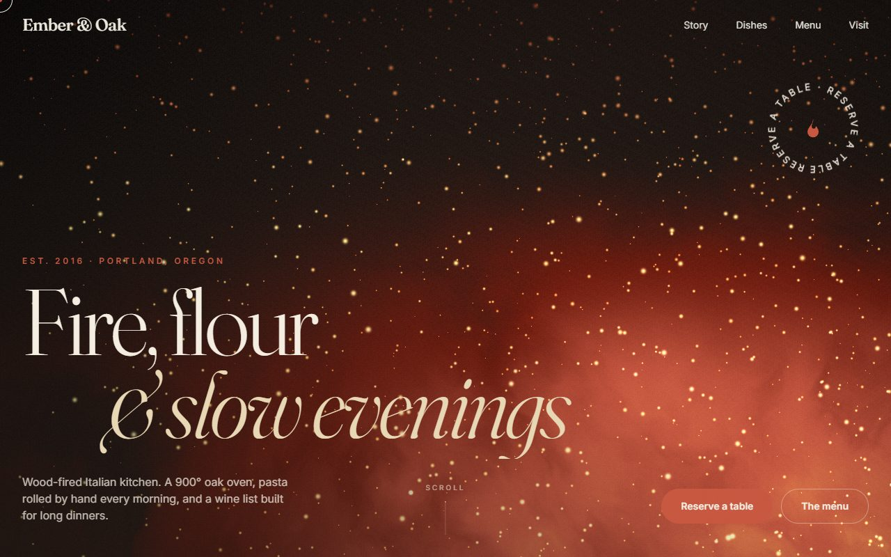
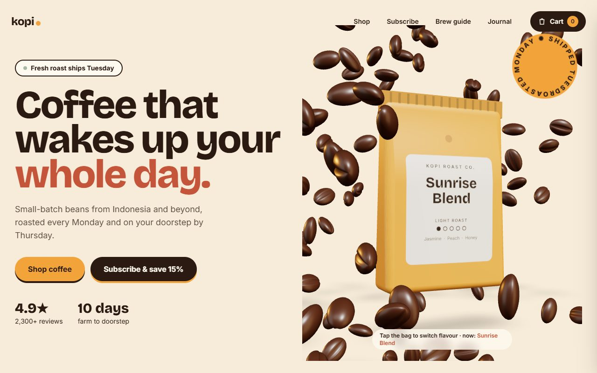
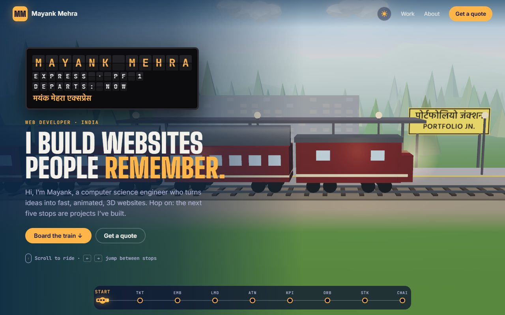

### Hi, I'm Mayank 👋

Computer science engineer (B.Tech CSE, 2026) building fast, animated, 3D websites for businesses, and full-stack products like **Schemo**.

#### Websites I've built

<table>
  <tr>
    <td width="33%"> <a href="https://ember-and-oak-9m9.pages.dev"><b>Ember &amp; Oak</b></a> Restaurant · WebGL fire</td>
    <td width="33%"> <a href="https://lumina-dental-a4x.pages.dev"><b>Lumina Dental</b></a> Dental clinic · 3D tooth</td>
    <td width="33%"> <a href="https://atelier-norte-djv.pages.dev"><b>Atelier Norte</b></a> Architecture studio · WebGL</td>
  </tr>
  <tr>
    <td width="33%"> <a href="https://kopi-roast.pages.dev"><b>Kopi Roast Co.</b></a> Online store · 3D product</td>
    <td width="33%"> <a href="https://orbit-ai-b4e.pages.dev"><b>Orbit AI</b></a> SaaS landing page · shaders</td>
    <td width="33%"> <a href="https://mayankmehra.pages.dev"><b>My portfolio</b></a> A 3D train ride through my work</td>
  </tr>
</table>

#### Also building

- **[Schemo](https://schemo.mmehraa13.workers.dev)**: helps Indian startups and MSMEs find the government schemes they qualify for. Next.js, Cloudflare.
- **[Karya](https://github.com/mmehraa/karya)**: an operating system for small businesses, from inventory to finance. Next.js, TypeScript.
- **[Virtual Mouse](https://github.com/mmehraa/Virtual-Mouse-Using-Hand-Gestures)**: control your computer with hand gestures. Python, OpenCV, MediaPipe.

#### Tech

#### Off the keyboard

🎬 I also edit videos, short-form and long-form. **[Watch my edits →](https://mmehraa.github.io/editor-portfolio/)**
