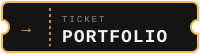
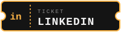
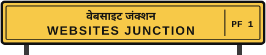
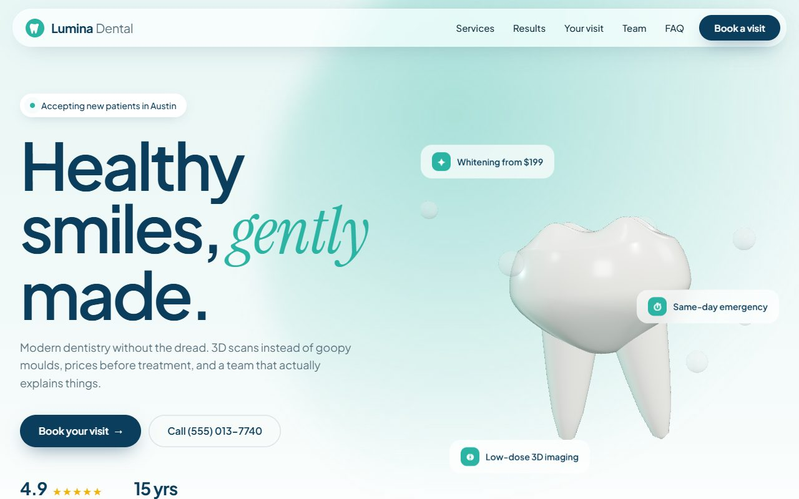
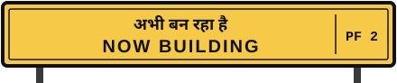
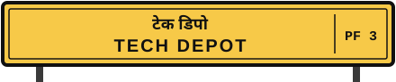
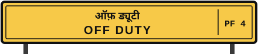

  Computer science engineer (B.Tech CSE, 2026) and frontend web developer. 
  I build <b>fast, animated, 3D websites</b> people remember, and full-stack products like <b>Schemo</b>.

  &nbsp;
  &nbsp;
  

 

<table>
  <tr>
    <td width="33%"> <code>EMB</code> <a href="https://ember-and-oak-9m9.pages.dev"><b>Ember &amp; Oak</b></a> Restaurant · real-time WebGL fire</td>
    <td width="33%"> <code>LMD</code> <a href="https://lumina-dental-a4x.pages.dev"><b>Lumina Dental</b></a> Dental clinic · 3D tooth in code</td>
    <td width="33%"> <code>ATN</code> <a href="https://atelier-norte-djv.pages.dev"><b>Atelier Norte</b></a> Architecture studio · WebGL transitions</td>
  </tr>
  <tr>
    <td width="33%"> <code>KPI</code> <a href="https://kopi-roast.pages.dev"><b>Kopi Roast Co.</b></a> Online store · 3D product configurator</td>
    <td width="33%"> <code>ORB</code> <a href="https://orbit-ai-b4e.pages.dev"><b>Orbit AI</b></a> SaaS launch page · GLSL shaders</td>
    <td width="33%"> <code>HOME</code> <a href="https://mayankmehra.pages.dev"><b>My portfolio</b></a> Ride the train through my work</td>
  </tr>
</table>

 

- **[Schemo](https://schemo.mmehraa13.workers.dev)**: helps Indian startups and MSMEs find the government schemes they qualify for.
- **[Karya](https://github.com/mmehraa/karya)**: an operating system for small businesses, from inventory to finance.
- **[Virtual Mouse](https://github.com/mmehraa/Virtual-Mouse-Using-Hand-Gestures)**: control your computer with hand gestures.

 

 

🎬 When I'm not coding, I edit videos: short-form and long-form. **[Watch my edits →](https://mayank-editor.pages.dev)**

 

