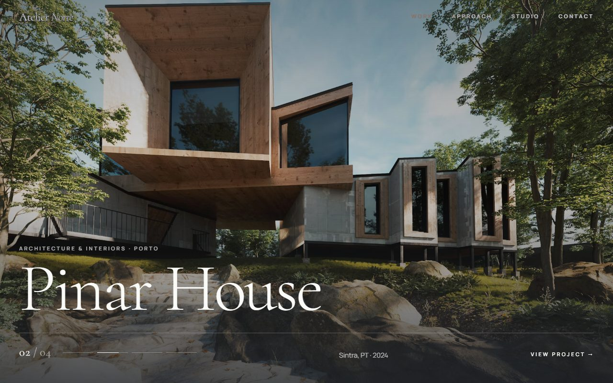
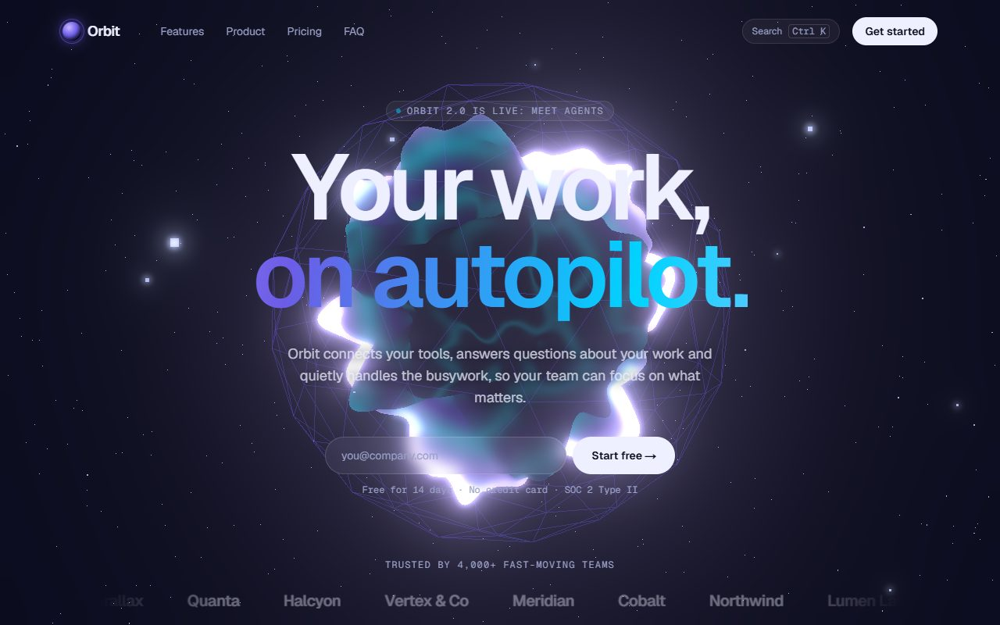
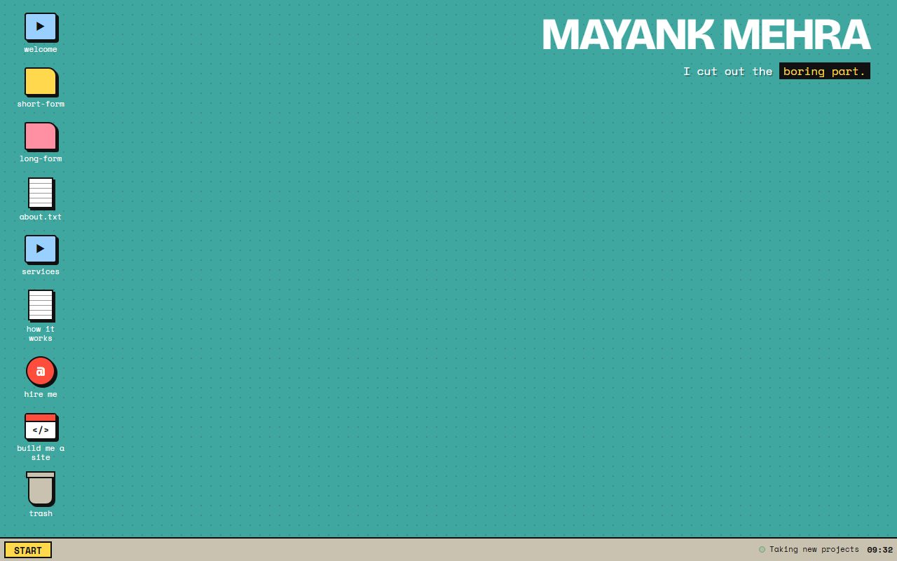

<h1 align="center">Hi, I'm Mayank 👋</h1>

  

  
  
  
  
  

---

I'm a computer science engineer (B.Tech CSE, 2026) and freelance web developer. I build **fast, animated, 3D websites**: restaurants, clinics, studios, online stores and launch pages, plus full-stack products like **Schemo**. If it should feel memorable and load fast, that's my kind of project.

## 🌐 Websites I've built

<table>
  <tr>
    <td width="50%" valign="top">
      
      <h3>Ember &amp; Oak</h3>
      Restaurant website with real-time WebGL fire: 1,800 embers that scatter from your cursor. 
      Astro · Three.js · GSAP · Tailwind 
      <a href="https://ember-and-oak-9m9.pages.dev"><b>Live site</b></a> · <a href="https://github.com/mmehraa/ember-and-oak">Code</a>
    </td>
    <td width="50%" valign="top">
      
      <h3>Lumina Dental</h3>
      Dental clinic site with a 3D tooth modelled in code, a whitening slider and online booking. 
      HTML · CSS · JavaScript · Three.js 
      <a href="https://lumina-dental-a4x.pages.dev"><b>Live site</b></a> · <a href="https://github.com/mmehraa/lumina-dental">Code</a>
    </td>
  </tr>
  <tr>
    <td width="50%" valign="top">
      
      <h3>Atelier Norte</h3>
      Architecture studio portfolio where photos melt into each other with a WebGL transition. 
      Nuxt · Vue · WebGL · GSAP Flip 
      <a href="https://atelier-norte-djv.pages.dev"><b>Live site</b></a> · <a href="https://github.com/mmehraa/atelier-norte">Code</a>
    </td>
    <td width="50%" valign="top">
      
      <h3>Kopi Roast Co.</h3>
      Online coffee shop with a 3D bag that re-prints its label as you pick size and grind. 
      Next.js · React Three Fiber · Decap CMS 
      <a href="https://kopi-roast.pages.dev"><b>Live site</b></a> · <a href="https://github.com/mmehraa/kopi-roast">Code</a>
    </td>
  </tr>
  <tr>
    <td width="50%" valign="top">
      
      <h3>Orbit AI</h3>
      SaaS launch page with a shader-built orb that follows you down the page, and a ⌘K palette. 
      Next.js · Three.js shaders · GSAP 
      <a href="https://orbit-ai-b4e.pages.dev"><b>Live site</b></a> · <a href="https://github.com/mmehraa/orbit-ai">Code</a>
    </td>
    <td width="50%" valign="top">
      
      <h3>My portfolio</h3>
      A train journey through my work: scroll to ride, and each station is a project. 
      Astro · Three.js · GSAP 
      <a href="https://mayankmehra.pages.dev"><b>Live site</b></a> · <a href="https://github.com/mmehraa/portfolio">Code</a>
    </td>
  </tr>
</table>

All five client sites are concept projects. Want one for your business? <a href="https://mayankmehra.pages.dev">Get a quote</a>.

## 🚀 Currently building

<table>
  <tr>
    <td>
      <h3>Schemo</h3>
      

        A free platform that helps Indian founders and small businesses find the <b>government and private schemes they can apply for</b>:
        grants, loans, subsidies and tax benefits across the central government and all 36 states and union territories.
      

      <ul>
        <li>An eligibility check that marks every scheme <i>eligible</i>, <i>maybe</i> or <i>not</i>, with the reasons. No sign-up.</li>
        <li>Free tools: GST and income tax calculators, GST invoice generator, loan EMI calculator, registration checklist.</li>
        <li>13 Indian languages, light and dark themes, built for phones first.</li>
        <li>A crawler that politely re-checks official government pages every 15 minutes and queues changes for review.</li>
      </ul>
      

        
        
        
        
        
      

      
<a href="https://schemo.mmehraa13.workers.dev"><b>Try it live →</b></a> &nbsp;·&nbsp; code is private for now

    </td>
  </tr>
</table>

## 🛠️ Other projects

| Project | What it does | Built with |
|---|---|---|
| [**Karya**](https://github.com/mmehraa/karya) | A business operating system: onboarding, products and unit economics, inventory, production, orders, finance, marketing and goals in one place | Next.js, TypeScript |
| [**Virtual Mouse**](https://github.com/mmehraa/Virtual-Mouse-Using-Hand-Gestures) | Control your computer with hand gestures: move, click, double-click and take screenshots, no touch needed | Python, OpenCV, MediaPipe |
| [**Code Optimizer**](https://github.com/mmehraa/code-optimizer) | A web app that rewrites Python code using AST transformations: dead-code removal, constant folding, strength reduction | Python, Flask |
| [**Doobie**](https://github.com/mmehraa/doobie) | A lightweight real-time chat app over WebSockets | Node.js, Socket.io |

## 🧰 Tech I work with

  

## 🎬 When I'm not coding: video editing

<table>
  <tr>
    <td width="45%" valign="top">
      
    </td>
    <td valign="top">
      <h3>"I cut out the boring part."</h3>
      I also edit videos, short-form and long-form. My editing portfolio is a retro desktop: double-click the folders to watch my edits, open <code>about.txt</code>, or hit <i>hire me</i>.
        
      <a href="https://mmehraa.github.io/editor-portfolio/"><b>Open the video portfolio →</b></a> &nbsp;·&nbsp; <a href="https://github.com/mmehraa/editor-portfolio">Code</a>
    </td>
  </tr>
</table>

## 📊 GitHub at a glance

  <picture>
    <source media="(prefers-color-scheme: dark)" srcset="https://github-readme-stats.vercel.app/api?username=mmehraa&disable_animations=true&show_icons=true&hide_border=true&bg_color=00000000&title_color=E58A52&icon_color=E58A52&text_color=C9D1D9&rank_icon=github" />
    
  </picture>
  <picture>
    <source media="(prefers-color-scheme: dark)" srcset="https://github-readme-stats.vercel.app/api/top-langs/?username=mmehraa&disable_animations=true&layout=compact&langs_count=8&hide_border=true&bg_color=00000000&title_color=E58A52&text_color=C9D1D9" />
    
  </picture>

  <picture>
    <source media="(prefers-color-scheme: dark)" srcset="https://streak-stats.demolab.com?user=mmehraa&hide_border=true&background=00000000&ring=E58A52&fire=E58A52&currStreakLabel=E58A52&sideNums=C9D1D9&sideLabels=8B949E&currStreakNum=C9D1D9&dates=8B949E&stroke=30363D" />
    
  </picture>

## 🐍 My contributions, eaten by a snake

  <picture>
    <source media="(prefers-color-scheme: dark)" srcset="https://raw.githubusercontent.com/mmehraa/mmehraa/output/github-snake-dark.svg" />
    
  </picture>

## 🎲 A bit more about me

<b>⚡ Fun facts</b> (click to open)

 

- My portfolio is a train you ride by scrolling, with a split-flap departure board and an e-ticket about me.
- My video portfolio is a retro desktop: films live in folders you double-click.
- I built a mouse you don't have to touch: wave a hand at the webcam and the cursor follows.
- Schemo started as "a list of schemes" and grew into eligibility checks, tax calculators and a crawler that checks government websites every 15 minutes.

<b>💬 Ask me about</b>

 

- 3D and animated websites with **Three.js**, **GSAP** and WebGL shaders
- Building full-stack apps with **Next.js** and **TypeScript**
- Government schemes for Indian startups and MSMEs (Schemo covers all 36 states and union territories)
- Video editing for short-form and long-form content

<b>🧭 What I'm looking for</b>

 

- Businesses that want a website people remember: restaurants, clinics, studios, stores, launches
- Founders and small business owners who can give feedback on [Schemo](https://schemo.mmehraa13.workers.dev)
- If that sounds like you, [get a quote](https://mayankmehra.pages.dev), [say hello](mailto:mmehraa13@gmail.com) or [connect on LinkedIn](https://www.linkedin.com/in/mmehraa/)

<b>💻 My setup</b>

 

- **Editor:** VS Code
- **OS:** Windows
- **Favourite stack:** Next.js or Astro, TypeScript, Three.js, GSAP, Tailwind CSS

---

Thanks for stopping by. Have a great day! ✨

